# Module 2: PUF Specificity Design

<a id="module2-1"></a>

## 2.1 Overview

PUF-directed RNA editing requires control of unwanted editing alongside activity at the intended site. Published PUF–APOBEC studies assess target activity together with bystander and transcriptome-wide off-target editing (Han et al., 2025). In our APOE editing assay, C388 is the intended editing endpoint, whereas C295 and C871 are the two principal bystander sites that we aim to suppress. Measuring all three sites allows us to assess whether a PUF variant preserves target activity while reducing unwanted editing elsewhere in the same transcript.

The PUF ranker concentrated higher-specificity variants within its predicted shortlist in the evaluated construct library. We ranked variants by the balance between target editing and these two bystander sites, using the fixed score:

S = C<sub>388</sub> − (C<sub>295</sub> + C<sub>871</sub>) / 2

Our two experimental batches contain 81 constructs. Sixty-six have measurements at all three sites, while the remaining 15 have partial measurements. All 66 complete scores satisfy S &gt; 0, defining the task as **relative specificity ranking within this measured library**.

Module 2 develops the RNA-recognition component through two complementary parts. Part I (Section 2.3) evaluates designed tripartite recognition motif (TRM) variants by **modeling their measured three-site editing profiles and ranking specificity**. Part II (Section 2.4) uses structure-conditioned sequence generation to explore **PUF scaffold substitutions and new TRM candidates**, extending the design space beyond previously characterized recognition combinations. Together, these parts connect evaluation of designed recognition motifs with generation of additional scaffold and recognition candidates.

<a id="module2-iteration"></a>

## 2.2 Model-guided experimental iteration

**We used model predictions to select five PUF candidates before constructing them.** We then tested those candidates in wet-lab experiments and used the measured editing profiles to guide the next model iteration.

The five-candidate panel included a double-repeat SNE construct with a favorable measured editing profile. Relative to its matched control, **C388 increased by 7.77 percentage points, while C295 and C871 decreased by 13.15 and 34.90 points**, respectively. This result connected model-guided selection to a useful experimental outcome and helped motivate ranking the combined three-site profile.

The measured editing profiles supported subsequent model assessment, including specificity ranking and feature comparisons. The grouped out-of-fold (OOF) analyses below evaluate this post-assay model iteration.

The development record began with contact descriptors from AlphaFold 3 (Abramson et al., 2024) for scaffold and endpoint assessment. After the five-candidate experiment, the modeling task developed toward continuous ranking of the combined editing profile. Frozen ESM representations and LoRA adaptation (Hu et al., 2021) were examined in computational iterations before the current assay-informed ranker.

Using predictions to prioritize a limited experimental panel follows a wider practice of model-assisted recommendation in synthetic biology (Radivojević et al., 2020).

<a id="module2-2"></a>

## 2.3 Part I. Assay-informed specificity ranking

### Model principles

We adapted the approach of Hsu et al. (2022), which combines evolutionary information with assay-labelled sequence features. Our implementation **joins a frozen ESM-2 score with reference-centred one-hot sequence encoding**, then fits Ridge regression to the measured editing outputs.

<a id="model-figure-10"></a>

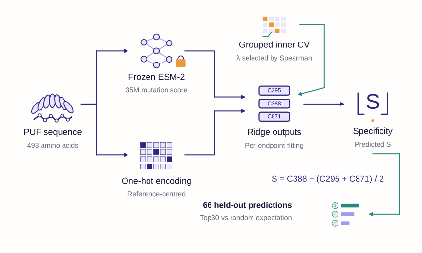

**Figure 10.** PUF-ESM combines ESM-2 mutation scores and one-hot features in Ridge regression to predict C295, C388 and C871 rates and derive specificity score S.

#### Sequence features and endpoint fitting

The evolutionary feature sums mutant-versus-reference log-probability differences at substituted residues. Each probability is computed from the reference sequence with that position masked, using frozen ESM-2 35M weights. This additive score summarizes position-wise sequence preferences, which the assay-fitted regressors map to editing rates. The pretrained ESM-2 model is described by Lin et al. (2023).

The second feature block encodes amino-acid substitutions relative to the fixed 493-residue reference. A separate Ridge regressor predicts each C value using its observed training labels. Available labels from all 81 constructs contribute when eligible for the training fold; **missing assay labels are masked during fitting**. The predictor combines frozen ESM-2 scores, one-hot features and Ridge regressors.

The two feature sources supply complementary information. One-hot encoding lets the assay data associate particular replacements with each editing endpoint; the frozen sequence score adds a pretrained preference for those replacements. Ridge regularization limits the size of the fitted coefficients (Hoerl and Kennard, 1970). The three regressors then translate these features into the project-specific objective S. A construct with an incomplete assay can inform an observed endpoint, but only a complete three-site measurement can support evaluation of S.

#### Grouped validation and parameter selection

Outer validation leaves out one sequence group at a time. Repeated measurements and identical sequences remain grouped, and every held-out group is excluded from all training records. Ranking metrics use the same 66 constructs with complete S throughout.

Within each outer training fold, two-fold grouped validation tests Ridge penalties of 0.1, 1, 10, 100 and 1,000, with evolutionary-feature weights of 1 or 10. Feature standardization uses training data only. Strategy A prioritizes inner Spearman correlation, followed by the measured mean S of the proportional predicted-top subset and then regression error. **Outer test labels are reserved for performance assessment.**

Nested validation separates parameter selection from performance assessment (Varma and Simon, 2006).

#### Core implementation

The following excerpt shows feature combination, masked per-target regression and specificity calculation. `selected_spec` is chosen using inner validation; `train_idx` excludes the held-out sequence group. `fit` uses observed labels for each C output and standardizes the ESM score within the training records.

```
from model import encode, fit, predict

onehot, esm_score = encode(sequences, reference, reference_logp)
models = fit(onehot, esm_score, Y, train_idx,
             "PUF_ESM", selected_spec)
C_hat = predict(models, onehot, esm_score, test_idx)
S_hat = C_hat[:, 1] - (C_hat[:, 0] + C_hat[:, 2]) / 2
```

Here, `Y` contains C295, C388 and C871 in that order. Missing labels remain masked for the corresponding endpoint regressor.

<a id="module2-ranking-results"></a>

### Results: overall ranking and Top-K recovery

The PUF-ESM Specificity Ranker reached **Spearman ρ = 0.405** and **Kendall τ = 0.264**. It had the highest Spearman correlation among the original 12 methods in the matched comparison and among the five feature ablations below.

Removing the evolutionary feature reduced Spearman correlation to 0.292 in the matched one-hot Ridge model using the same A selection rule. Frozen local ESM plus Ridge reached 0.289 under its B selection rule. This latter comparison evaluates configurations with different feature blocks and selection rules.

<a id="model-figure-11"></a>

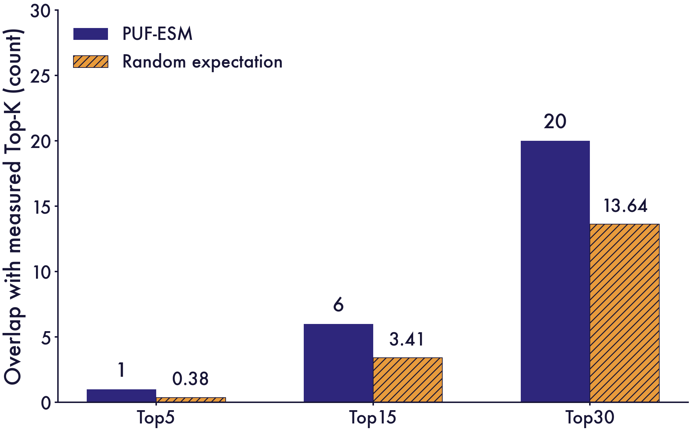

**Figure 11.** Top-K overlap between predicted and measured rankings among 66 constructs. Random expectation is K²/66.

The model recovered 1, 6 and 20 measured Top-K members at K = 5, 15 and 30, respectively. The displayed cutoffs exceeded their random expectations. At Top30, the model recovered 20 of the 30 highest-scoring constructs, corresponding to a 66.7% hit rate. Uniform random selection would recover 13.64 on average, or 45.5%. The selected constructs had a measured mean S of 0.292, compared with 0.245 across all 66 constructs. The shortlist captures about two-thirds of the measured Top30, concentrating high-specificity variants into a smaller panel for follow-up.

Top30 is a retrospective reporting cutoff applied to the fixed OOF predictions. Within the 66-construct cohort, the predicted Top30 was enriched for higher measured specificity. The random expectation describes drawing constructs uniformly from this same cohort.

The practical benefit is enrichment of a testing panel: the predicted Top30 contains more high-scoring constructs than random selection would recover on average. Top5 recovered one member, favoring **prioritization of a candidate panel** over selection of a single winner. The three-site score and the RNA-seq profiles in Module 1 provide complementary measures for follow-up.

<a id="model-figure-12"></a>

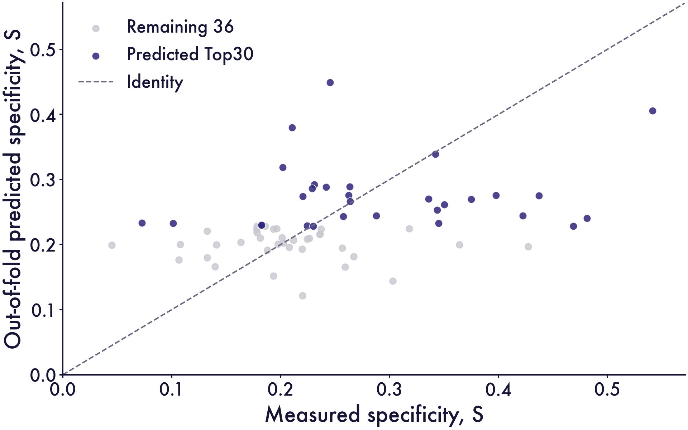

**Figure 12.** Measured versus out-of-fold predicted specificity score S for 66 constructs, highlighting the predicted Top30. The dashed line marks equality.

<a id="module2-feature-ablations"></a>

#### Feature ablations: position, amino-acid identity and evolutionary score

We tested whether ranking depended on mutation location, amino-acid identity or the evolutionary score. The position-only baseline uses a 493-dimensional binary vector to record substituted positions. The amino-acid model uses the 493 × 20 reference-centred one-hot difference encoding: −1 for the reference residue and +1 for its replacement at each mutated position.

All supervised variants predict the three C values separately, using available labels from the same 81-construct pool. They reuse the identical 66 outer sequence-group folds, inner partitions, Ridge penalty grid and A selection rule.

The zero-shot control ranks the fixed ESM-2 mutation score in descending order, with higher pretrained log-odds ranked higher. The score-only Ridge control evaluates supervised calibration of this single feature using the assay labels.

<a id="model-figure-13"></a>

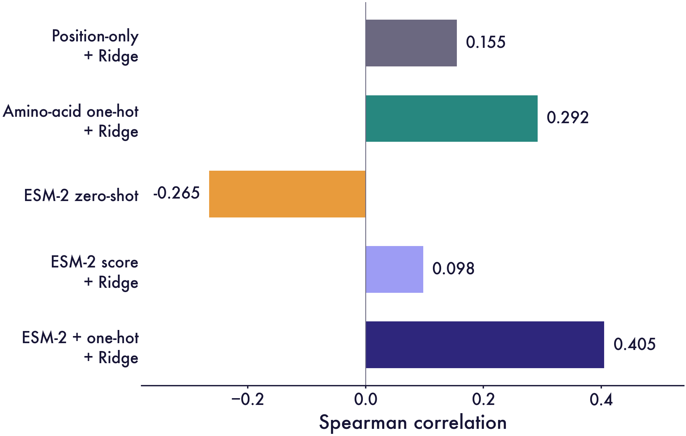

**Figure 13.** Spearman correlations for five feature ablations, using grouped out-of-fold predictions for the same 66 constructs.

<a id="model-figure-14"></a>

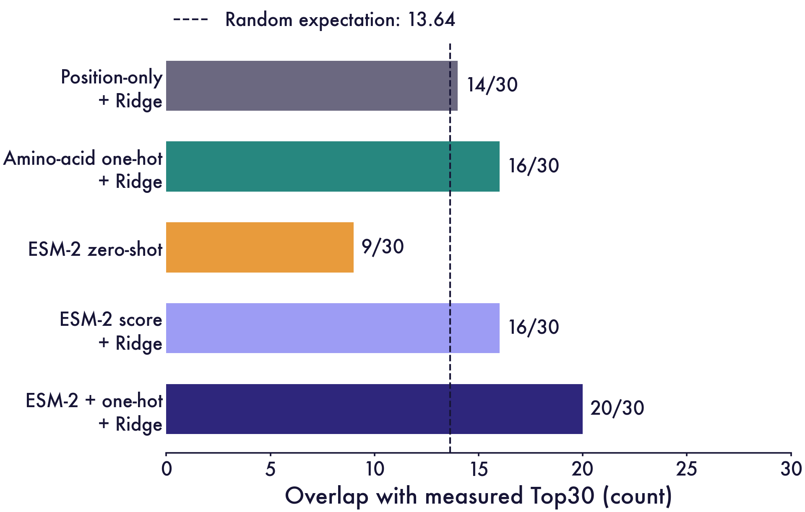

**Figure 14.** Measured Top30 recovery across five feature ablations. The dashed line marks random expectation: 13.64 of 30 constructs.

**Position-only ranking remained close to the random-selection expectation.** Position-only Ridge reached ρ = 0.155 and recovered 14 of the measured Top30, compared with the random expectation of 13.64. Its selected mean S was 0.241, compared with 0.245 across the full cohort.

**Amino-acid identity improves the point estimates.** Adding identity through position-specific one-hot features increased ρ from 0.155 to 0.292 and Top30 recovery from 14 to 16. These results suggest that the substituted residue contributes information beyond mutation location within this library.

**The uncalibrated ESM-2 score had negative rank agreement.** The additive reference-masked score reached ρ = −0.265 and recovered 9 of the measured Top30 in descending score order. Fitting Ridge to the score increased recovery to 16, with ρ = 0.098.

**Combining the two feature sources performs best within this ablation.** The combined model reached ρ = 0.405 and recovered 20 of the measured Top30. Relative to amino-acid one-hot Ridge, this corresponds to Δρ = 0.113 and four additional hits; relative to score-only Ridge, Δρ = 0.307 and four additional hits. The combined selected mean S was 0.292, versus 0.259 for one-hot Ridge and 0.264 for score-only Ridge. Thus, this comparison supports a benefit from combining the features after assay-based fitting, despite poor direct zero-shot ranking.

Across the same grouped folds, the combined features produced stronger rank agreement and recovered more high-specificity constructs than either feature source alone. Sequence-group holdout evaluates variants within this library, with examples at the same mutation positions potentially present in training.

<a id="module2-readout-layers"></a>

#### Sensitivity to ESM-2 readout depth

We tested sensitivity to ESM-2 readout depth within the main model's **reference-masked mutation score + reference-centred one-hot encoding + Ridge** pipeline. Only the readout depth varied across blocks 1–12. The analysis used the same 81-construct pool of observed C labels, 66 sequence-group outer test folds, inner partitions, Ridge penalties, score weights and A selection rule.

At each substituted position, the reference sequence was masked and the mutant-minus-reference log probability was read from the selected layer, then summed across substitutions. Blocks 1–11 used the frozen final encoder normalization and pretrained vocabulary prediction head; block 12 used its native normalized output. This shared-head **logit-lens diagnostic** reads intermediate states through a head trained for the final layer. The block-12 control reproduced the main-model predictions.

<a id="model-figure-15"></a>

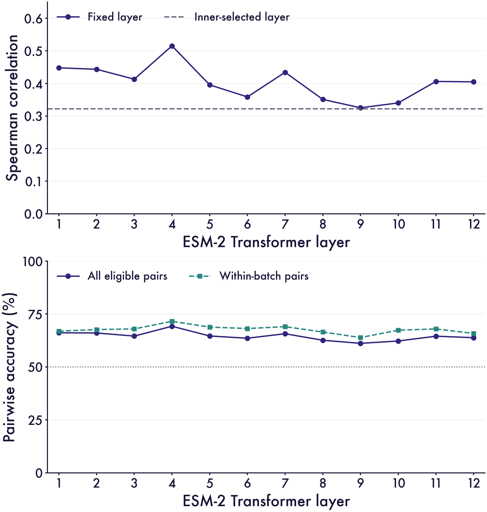

**Figure 15.** ESM-2 readout-layer sensitivity: grouped outer-OOF Spearman correlation above and all-pair/within-batch accuracy below. Pairs with |ΔS| ≤0.01 are excluded; ties score 0.5. The dashed reference selects layers within inner validation.

<a id="model-figure-16"></a>

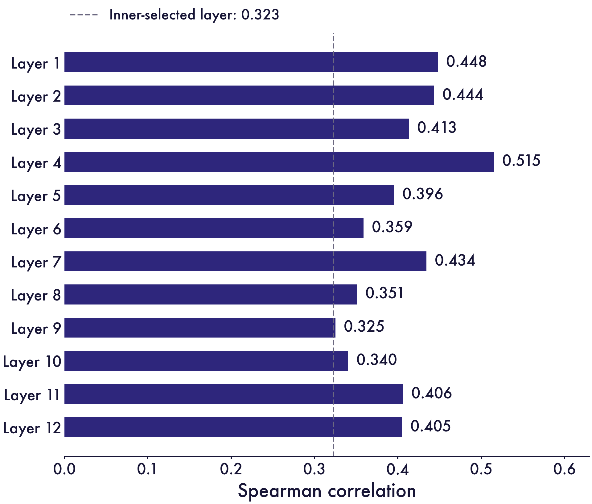

**Figure 16.** Grouped outer-OOF Spearman correlations across twelve ESM-2 readout layers for 66 constructs. The dashed line marks the inner-selected-layer pipeline (ρ =0.323).

The highest fixed-layer Spearman estimate was **0.515 at layer 4**, compared with **0.405 at layer 12**.

<a id="model-figure-17"></a>

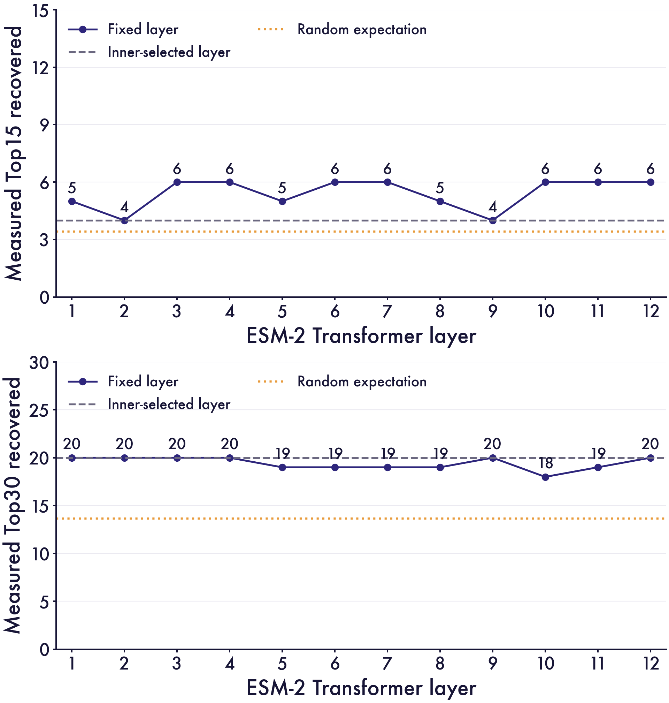

**Figure 17.** Top15 and Top30 recovery across ESM-2 readout layers for 66 constructs. Random expectations are 3.41 and 13.64; dashed lines show the inner-selected-layer pipeline.

The largest observed Top15 overlap was **6/15**, attained at layer(s) 3, 4, 6, 7, 10, 11, 12. The largest Top30 overlap was **20/30**, attained at layer(s) 1, 2, 3, 4, 9, 12; its random-selection enrichment was **1.47×**. Layer 12 recovered 6/15 and 20/30, respectively.

We also selected the layer and Ridge configuration using only the inner validation of each outer fold. This pipeline reached **Spearman 0.323, Top15 4/15 and Top30 20/30**, evaluating the layer-selection procedure within the measured library. The fixed-layer and inner-selected-layer analyses assess representation choice and the selection procedure, respectively.

#### Five highlighted constructs

These five constructs appear in both the predicted and measured Top30 sets in the grouped OOF assessment. They illustrate high measured specificity, with predicted and measured ranks differing by 7–20 places.

<a id="model-figure-18"></a>

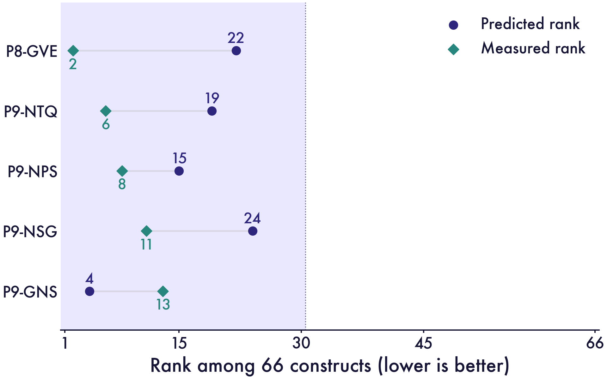

**Figure 18.** Current out-of-fold and measured ranks of five highlighted constructs among 66 candidates. All five enter the predicted Top30.

#### Retrospective examples of agreement at higher and lower ranks

We selected five examples with higher specificity and five with lower specificity, excluding the five previously highlighted constructs. Higher-ranked examples must appear in both predicted and measured Top30 sets. Lower-ranked examples must appear in both bottom-30 sets, corresponding to ranks 37–66.

Within each eligible group, we selected the five smallest absolute differences between predicted and measured ranks, breaking ties by absolute S error and then construct identifier. This retrospective selection illustrates agreement at higher and lower ranks within the positive-score library; the full-cohort metrics summarize overall performance.

<a id="model-figure-19"></a>

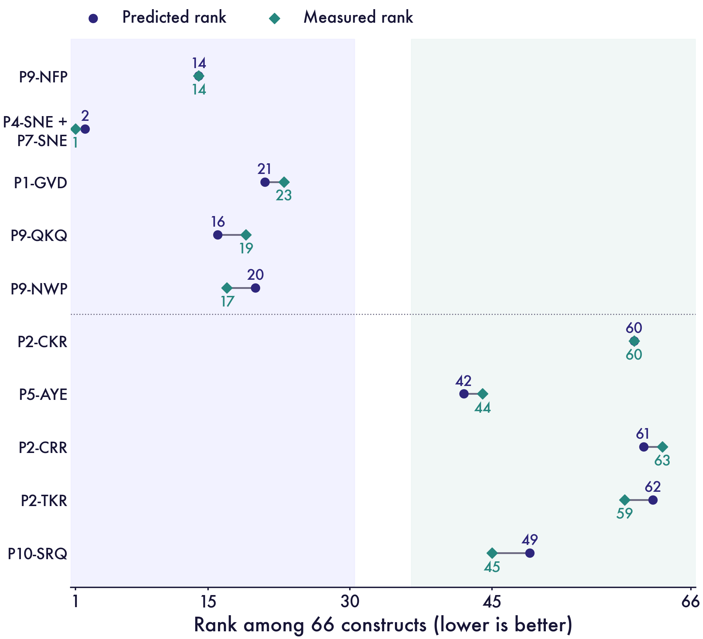

**Figure 19.** Five higher-ranked and five lower-ranked examples selected retrospectively for close predicted and measured ranks.

The higher-ranked examples differ from their measured ranks by 0–3 places; the lower-ranked examples differ by 0–4 places. Rank agreement and absolute-score calibration are distinct properties. P4-SNE + P7-SNE ranks second by prediction and first by measurement, with predicted S of 0.406 and measured S of 0.541.

#### Sequence-only inference

The deployment model uses the prespecified A selection rule on all available training data, with fitted inference weights separate from the OOF evaluation. Sequence-only inference accepts a fixed-length 493-residue PUF FASTA sequence using standard amino acids and the model's reference-scoring table.

<a id="module2-3"></a>

## 2.4 Part II. Structure-conditioned PUF design and experimental comparison

### Design rationale

PUF recognition follows a modular principle: each repeat typically recognizes one RNA base through three amino-acid residues, termed a **tripartite recognition motif (TRM)**. Two residues contact the base edge, while the third contributes stacking interactions. The surrounding PUF scaffold supports the spatial arrangement of these recognition elements (Wang et al., 2002; Cheong &amp; Hall, 2006).

Building on this recognition rule, Part II explores both the amino-acid sequence of the **PUF scaffold and new TRM candidates**. The design space extends beyond previously characterized TRM combinations to alternative recognition-residue identities and substitutions elsewhere in the scaffold. Structure-conditioned sequence generation proposes these candidates on a fixed protein backbone. Our objective was to identify structure-compatible candidates and compare their sequence preferences with measured editing profiles. Engineering of PUF binding specificity and affinity provides the biological context for these choices (Zhao et al., 2018).

We followed the single-substitution screening logic of AiCE, combining inverse-folding preferences with structural constraints (Fei et al., 2025). Our implementation is an **AiCE-inspired single-substitution screen using PyDSSP three-state assignments**.

### Models and two design spaces

ProteinMPNN conditions sequence generation on protein backbone geometry (Dauparas et al., 2022). LigandMPNN additionally represents nonprotein atomic context, including nucleotides (Dauparas et al., 2025). LigandMPNN received the fixed RNA coordinates, while ProteinMPNN provided the protein-backbone comparison. Both use pretrained parameters for structural inference, with editing measurements supplying the assay comparison.

Both analyses used the same 493-residue PUF reference and the 17-nucleotide RNA sequence `ACAUGGAGGACGUGCGC`. Protein substitutions use one-based residue numbering; C295, C388 and C871 are RNA assay-endpoint labels. Endpoint C388 maps to nucleotide 15 of this structural fragment.

<a id="model-figure-20"></a>

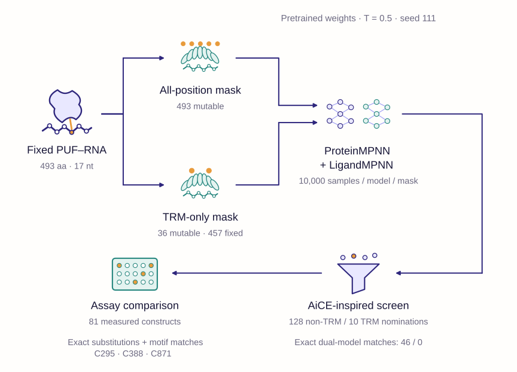

**Figure 20.** All-position and TRM-only design with ProteinMPNN and LigandMPNN, using 10,000 sequences per model and design space, followed by structural screening and assay comparison.

| Analysis | Mutable protein positions | Fixed protein positions | Sampling source | Reported screen |
| --- | --- | --- | --- | --- |
| All-position sampling | 493 | 0 | Archived 10,000 sequences per model | Non-TRM substitutions after excluding 36 recognition positions |
| TRM-only sampling | 36 | 457 | Newly generated 10,000 sequences per model | All 36 recognition positions; all amino-acid substitutions permitted |

All-position sampling makes every residue eligible for replacement, with the number of substitutions varying among sequences. Non-TRM single-mutant candidates are then placed on the WT background, preserving all recognition residues.

For each position, each model nominated its most frequent alternative when its frequency exceeded the WT frequency and reached 0.8 globally, or 0.5 at a PyDSSP loop position. Exact dual-model consensus requires both models to support the **same replacement** under the applicable threshold. Screening uses β = 0.8 and γ = 0.5.

### All-position sampling expands the non-TRM candidate set

The structural screen yielded **128 non-TRM substitutions at 125 positions**, including **46 exact dual-model consensus substitutions**. Global-only screening yielded 81 substitutions at 81 positions, including 17 consensus substitutions. Structural screening retained all 81 and added 47 substitutions at 44 additional positions. Twenty-nine substitutions gained consensus support, including substitutions already nominated by one model.

<a id="model-figure-21"></a>

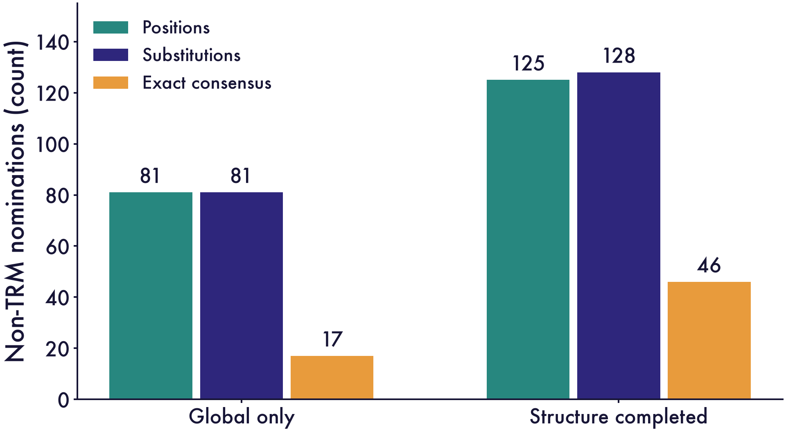

**Figure 21.** Non-TRM nominations before and after structural screening. Exact consensus requires both models to support the same substitution.

PyDSSP assigns loop, helix and strand states as `-`, `H` and `E`. The annotation identified 129 loop, 360 helical and four strand residues, with loop assignment serving as the structural proxy for the lower frequency threshold. Positions 177, 249 and 285 favor different substitutions in the two models and fall outside exact consensus.

The model frequencies nominate **N12G, M433L and V457I**. All 128 single-mutant sequences were checked against the reference, with TRM positions preserved.

### TRM-only generation produces model-specific nominations

Each TRM-only run completed 10,000 samples with all 457 non-TRM residues fixed. LigandMPNN produced 9,961 unique sequences and averaged 21.53 TRM substitutions per sample. ProteinMPNN produced 10,000 unique sequences and averaged 29.25 substitutions. The sampled sequences therefore usually combined many recognition changes.

All 36 TRM residues were assigned helix, so the 0.5 loop route did not apply. LigandMPNN nominated **10 substitutions**, whereas ProteinMPNN nominated **none**. Consequently, the TRM-only screen had **zero exact dual-model consensus substitutions**.

<a id="model-figure-22"></a>

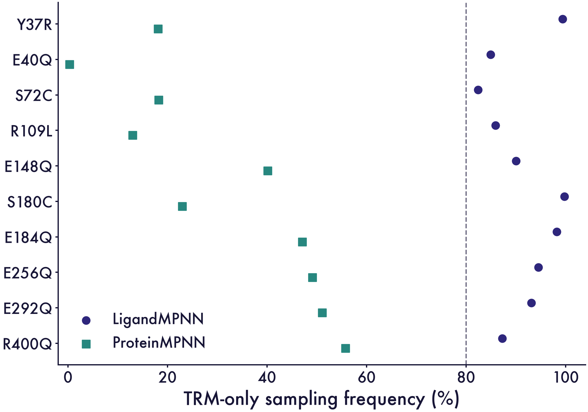

**Figure 22.** Frequencies of ten nominated substitutions in 10,000 TRM-only samples per model. The dashed line marks the 80% threshold.

The models differ in both atomic conditioning and pretrained parameters, providing complementary structural views of substitution preference.

### Experimental overlap, similarity and disagreement

The assay dataset contains 168 records across 81 mutant constructs and three control groups, with two records per group. Sequence mapping identified 121 distinct substitutions across 31 positions, all within the configured TRM region.

The **128 non-TRM nominations** extend the design space beyond the TRM positions represented in these assays. Within the TRM nominations, **Y37R, E184Q and S72C** occur among measured substitutions. Y37R and E184Q were tested individually, while the S72C outcomes belong to multi-mutant constructs.

These three substitutions represent 3/10 nominated substitutions and 3/121 measured distinct substitutions. Sequence coverage is reported for all 81 constructs at three match levels: specified substitutions, affected TRM triplets and the complete protein sequence.

<a id="model-figure-23"></a>

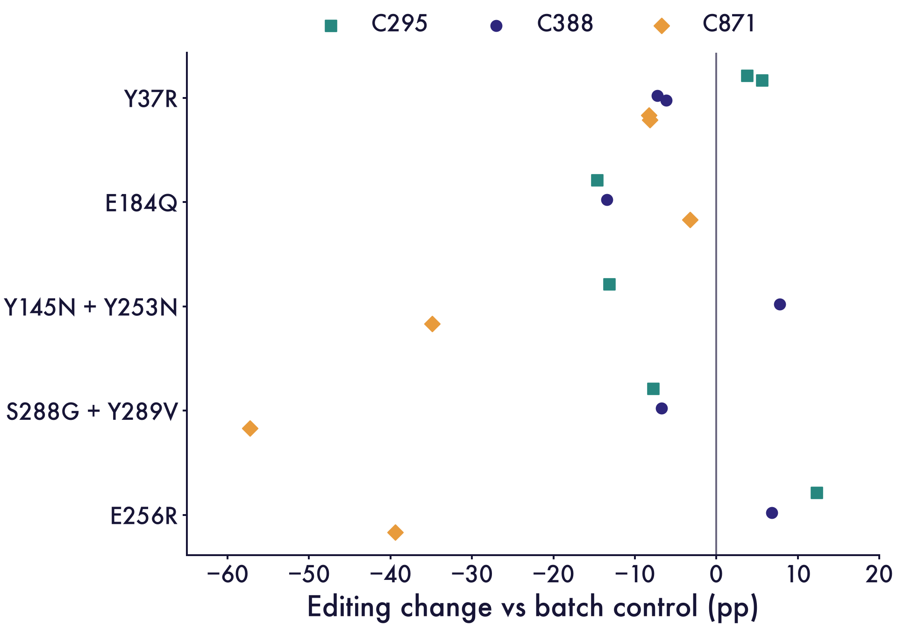

**Figure 23.** Editing changes relative to same-batch controls, with two records per mean. Y37R is compared separately with both batch-2 controls.

Across all 81 measured constructs, at least one TRM-only sample contained every specified substitution for 23 constructs with LigandMPNN and 35 with ProteinMPNN. Requiring complete affected TRM triplets reduced coverage to 13 and 20 constructs, respectively; full-length matches were zero for both models. Coverage counts use any observed sample occurrence, while nomination uses the 80% threshold.

| Match definition | LigandMPNN construct coverage | ProteinMPNN construct coverage |
| --- | --- | --- |
| All specified substitutions present; other residues unconstrained | 23/81 (28.4%) | 35/81 (43.2%) |
| All affected TRM triplets match; other triplets unconstrained | 13/81 (16.0%) | 20/81 (24.7%) |
| Entire 493-residue experimental sequence matches | 0/81 | 0/81 |

**Strongly sampled Y37R and E184Q had lower C388 signals than their same-batch controls.** Y37R occurred in 99.40% of LigandMPNN samples, with measured C388 of 60.39% against batch-2 controls of 67.64% and 66.53%. E184Q occurred in 98.22% of samples, with C388 of 59.12% against the batch-1 control of 72.56%. These results favor selecting structural proposals by their measured editing profiles.

**Measured editing profiles contributed candidates beyond the sampled substitutions.** Y145N + Y253N increased C388 by 7.77 percentage points while reducing C295 and C871 by 13.15 and 34.90 points. P8-GVE, carrying S288G + Y289V, reduced C388 by 6.70 points and C871 by 57.27 points. The joint S288G + Y289V set was absent from both 10,000-sample TRM-only runs.

**Exact residue identity matters when comparing model nominations with measured variants.** The model nominated E256Q, while P7-SYVIRR carries E256R and has arginine at the adjacent position 257. E256R increased C388 by 6.82 points, reduced C871 by 39.44 points and increased C295 by 12.30 points. E256Q and E256R define an exact-substitution comparison for the next assay.

The assay comparison retains nondetection flags alongside the recorded endpoint values. The ranker uses valid observed labels for fitting and evaluates S in the 66 complete-score constructs.

### WT-background scoring and interpretation

We scored each nominated TRM substitution individually on the WT background. Scores average eight shared decoding orders and measure mean log probability over the 36 TRM positions, providing a separate check of single-mutant sequence preference.

<a id="model-figure-24"></a>

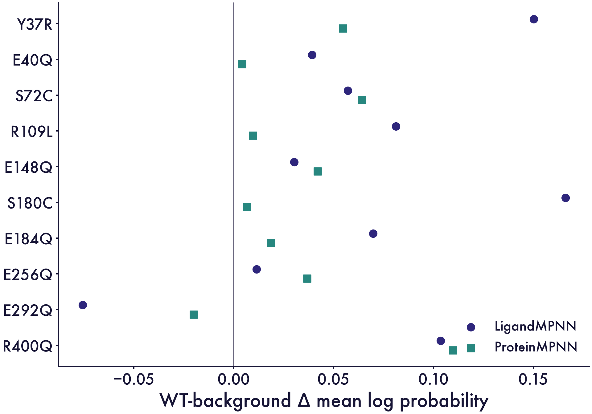

**Figure 24.** Mean TRM log-probability changes versus WT, averaged over eight decoding orders. Positive values indicate model preference.

For E292Q, the WT-background score changes were −0.0756 for LigandMPNN and −0.0200 for ProteinMPNN. The other nine candidates increased both scores. Marginal frequencies from multi-mutant samples and WT single-mutant scores describe different sequence configurations.

### Next experiments

The assay comparison assigns complementary roles to the two design approaches: **inverse folding proposes structure-compatible sequences**, while the assay-informed ranker estimates relative three-site specificity within the measured library. Candidates with the desired profile can be assessed alongside Module 3 catalytic designs and the broader RNA-seq profiles in Module 1.

The next experiments should separate scaffold improvement, recognition changes and editing specificity. Non-TRM candidates should first be added individually to characterized TRM backgrounds, with unchanged parental controls. TRM candidates should be tested individually before evaluating combinations, including exact alternatives at shared positions such as E256Q and E256R.

Direct binding assays should compare the fixed target RNA with defined alternative RNAs. Matched editing experiments should measure all three endpoints, together with expression and protein integrity where feasible. These experiments would distinguish binding effects from changes in expression, catalytic positioning or cellular context.


### Residue identity improves ranking within the measured library


Within the evaluated library, position-only Ridge reached Spearman ρ = 0.155, position-specific amino-acid one-hot Ridge reached 0.292, and the combined one-hot and frozen ESM model reached 0.405. Residue identity and assay-calibrated evolutionary information strengthen the ranking of variants from this measured sequence space.


Matched three-site measurements on a new recognition background would extend this assessment and connect recognition design with catalytic preference.


### Protein sequence and RNA context guide recognition design


Protein-variant ranking and the exclusive-site context comparisons in Module 4 provide complementary views of recognition design. Engineered-PUF binding experiments show that repeat number and stacking-residue identity affect RNA affinity (Zhao et al., 2018). Together, these observations motivate joint assessment of RNA context and the three-site editing profile in the intended assay.

<a id="module2-5"></a>

## 2.5 Reproducibility and availability

The Module 2 repository contains the PUF ranking implementation, fitted inference weights, a cached reference-scoring table, dependency specifications and example inputs. The fixed assay dataset, recorded validation splits, fold results, training scripts, comparison tables and plotting sources support inspection and reproduction of the documented feature-ablation evaluation. Editable workflow artwork and exported figures accompany these records. The archived material supports reuse of the ranking workflow; it does not contain the complete structure-conditioned design package. Reported model performance remains development-stage cross-validation.

- [Module 2 GitHub repository](https://github.com/pdx12320/igem_module2)

<a id="module2-6"></a>

## 2.6 References

1. Abramson, J., Adler, J., Dunger, J., Evans, R., Green, T., Pritzel, A., Ronneberger, O., Willmore, L., Ballard, A. J., Bambrick, J., Bodenstein, S. W., Evans, D. A., Hung, C.-C., O’Neill, M., Reiman, D., Tunyasuvunakool, K., Wu, Z., Žemgulytė, A., Arvaniti, E., … Jumper, J. M. (2024). Accurate structure prediction of biomolecular interactions with AlphaFold 3. *Nature, 630*(8016), 493–500. doi:10.1038/s41586-024-07487-w
2. Hu, E. J. et al. (2021). LoRA: Low-Rank Adaptation of Large Language Models. arXiv:2106.09685
3. Radivojević, T., Costello, Z., Workman, K., &amp; Garcia Martin, H. (2020). A machine learning Automated Recommendation Tool for synthetic biology. *Nature Communications, 11*, Article 4879. doi:10.1038/s41467-020-18008-4
4. Hsu, C., Nisonoff, H., Fannjiang, C., &amp; Listgarten, J. (2022). Learning protein fitness models from evolutionary and assay-labeled data. *Nature Biotechnology, 40*(7), 1114–1122. doi:10.1038/s41587-021-01146-5
5. Lin, Z., Akin, H., Rao, R., Hie, B., Zhu, Z., Lu, W., Smetanin, N., Verkuil, R., Kabeli, O., Shmueli, Y., dos Santos Costa, A., Fazel-Zarandi, M., Sercu, T., Candido, S., &amp; Rives, A. (2023). Evolutionary-scale prediction of atomic-level protein structure with a language model. *Science, 379*(6637), 1123–1130. doi:10.1126/science.ade2574
6. Hoerl, A. E., &amp; Kennard, R. W. (1970). Ridge Regression: Biased Estimation for Nonorthogonal Problems. *Technometrics, 12*(1), 55–67. doi:10.1080/00401706.1970.10488634.
7. Varma, S., &amp; Simon, R. (2006). Bias in error estimation when using cross-validation for model selection. *BMC Bioinformatics, 7*, 91. doi:10.1186/1471-2105-7-91.
8. Wang, X., McLachlan, J., Zamore, P. D., &amp; Hall, T. M. (2002). Modular recognition of RNA by a human Pumilio-homology domain. *Cell, 110*(4), 501–512. doi:10.1016/S0092-8674(02)00873-5
9. Cheong, C. G., &amp; Hall, T. M. T. (2006). Engineering RNA sequence specificity of Pumilio repeats. *Proceedings of the National Academy of Sciences, 103*(37), 13635–13639. doi:10.1073/pnas.0606294103
10. Zhao, Y.-Y., Mao, M.-W., Zhang, W.-J., Wang, J., Li, H.-T., Yang, Y., Wang, Z., &amp; Wu, J.-W. (2018). Expanding RNA binding specificity and affinity of engineered PUF domains. *Nucleic Acids Research, 46*(9), 4771–4782. doi:10.1093/nar/gky134
11. Fei, H., Li, Y., Liu, Y., Wei, J., Chen, A., &amp; Gao, C. (2025). Advancing protein evolution with inverse folding models integrating structural and evolutionary constraints. *Cell, 188*(17), 4674–4692.e19. doi:10.1016/j.cell.2025.06.014
12. Dauparas, J., Anishchenko, I., Bennett, N., Bai, H., Ragotte, R. J., Milles, L. F., Wicky, B. I. M., Courbet, A., de Haas, R. J., Bethel, N., Leung, P. J. Y., Huddy, T. F., Pellock, S., Tischer, D., Chan, F., Koepnick, B., Nguyen, H., Kang, A., Sankaran, B., … Baker, D. (2022). Robust deep learning–based protein sequence design using ProteinMPNN. *Science, 378*(6615), 49–56. doi:10.1126/science.add2187
13. Dauparas, J., Lee, G. R., Pecoraro, R., An, L., Anishchenko, I., Glasscock, C., &amp; Baker, D. (2025). Atomic context-conditioned protein sequence design using LigandMPNN. *Nature Methods, 22*(4), 717–723. doi:10.1038/s41592-025-02626-1
14. Han, W., et al. (2025). Effective in vivo RNA base editing via engineered cytidine deaminase APOBECs fused with PUF proteins. *Nature Communications, 16*, 9727. doi:10.1038/s41467-025-64748-6. See also the 2026 author correction, doi:10.1038/s41467-026-76669-z.
